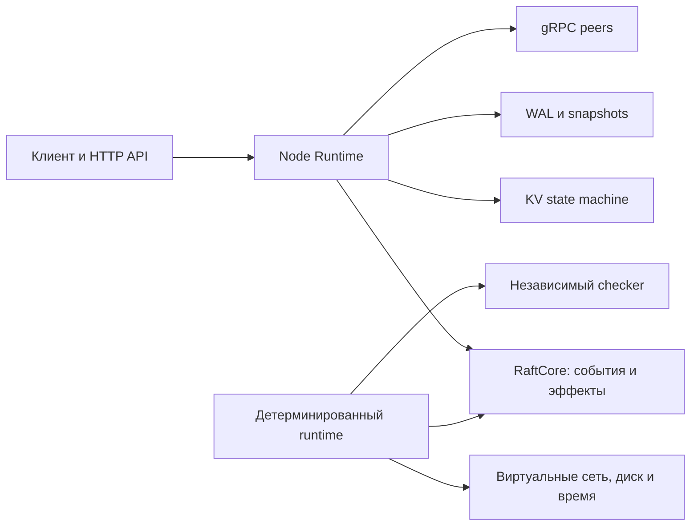

# Архитектура и вопросы перед реализацией

Статус: разбор предоставленного ТЗ от 6 ноября 2026 года. Это входные требования и предложения к уточнению, а не новый утверждённый дизайн. Подробности и исходные формулировки — в [спецификации](TECHNICAL_SPECIFICATION.md).

## Назначение и границы

QuorumLab демонстрирует реализацию консенсуса, хранения, восстановления и поиска ошибок. Успех — воспроизводимо показать, что подтверждённые операции сохраняются в заданной модели сбоев, а история KV соответствует линейризуемости.

В v1: одна Raft-группа, ровно три JVM-процесса с постоянным membership, quorum 2/3 и отдельными каталогами данных. Узлы могут падать и перезапускаться; сеть может задерживать, терять, дублировать и переставлять сообщения. Byzantine-поведение исключено. Для прогресса требуется достаточно длительная стабильная связь большинства; безопасность не должна зависеть от фиксированного верхнего предела сетевой задержки.

Вне v1: SQL, secondary indexes, multi-key transactions, sharding, dynamic membership/joint consensus, multi-region, multi-tenancy, production auth/TLS, lease reads, exactly-once delivery и собственный LSM-tree. Поведение оборудования, нарушающего контракт fsync, не входит в заявленные гарантии.

## Стек из материалов

| Область | Опорный выбор | Статус |
|---|---|---|
| Язык и сборка | Java 21, Gradle Kotlin DSL | Указаны в материалах; версии Gradle/плагинов выбрать в M0 |
| Алгоритм | Собственный RaftCore, только JDK в core | Центральное требование |
| Данные | In-memory KV + собственные WAL, HardState, snapshots | Центральное требование; не готовая БД |
| Peer transport | gRPC + Protocol Buffers | Указаны в ТЗ; согласовать версии и wire envelope |
| HTTP | Spring Boot как внешний adapter | Поясняющий текст предлагает; основное ТЗ только допускает, окончательный выбор открыт |
| Тесты | JUnit 5, AssertJ, jqwik, Testcontainers, Toxiproxy | Из материалов; конкретные версии и конфигурации не проверены |
| Метрики | Micrometer, Prometheus, Grafana | Предложены поясняющим текстом; обязательна наблюдаемость, детали внедрения позже |
| UI | React + TypeScript | Поздний M9 |
| CI | GitHub Actions | После появления репозитория; Linux storage/integration jobs |

PostgreSQL, Kafka и Redis не являются обязательными runtime-зависимостями. Готовый Raft полезен для изучения и сверки, но заменил бы собственный алгоритм, составляющий цель проекта.

Сравнение конкретных HTTP-adapter и версий библиотек оставлено до проектирования соответствующего этапа: сейчас не вводится новый стек и не утверждается его актуальная совместимость.

## Модули

| Модуль | Ответственность |
|---|---|
| `quorum-core` | Role/term/vote, election, replication, commit rule, protocol snapshots; Event → Effects |
| `quorum-storage` | WAL, durable metadata, integrity, replay, snapshots |
| `quorum-transport` | Protobuf/gRPC и преобразование peer RPC |
| `quorum-kv` | Детерминированные значения, revisions, tombstones, CAS, dedup |
| `quorum-node` | Event loop, исполнение эффектов, backpressure, RPC/HTTP, shutdown |
| `quorum-client` | Request identity, последовательность сессии, retries, поиск лидера |
| `quorum-simulator` | Виртуальное время/сеть/диск, scheduler, faults, trace |
| `quorum-checker` | Независимая KV-модель, history checker, invariant assertions |
| `quorum-integration` | Многопроцессные проверки и реальные сетевые сбои |
| `quorum-bench` | Workloads, manifest, обработка измерений |
| `quorum-dashboard` | Наблюдение и демонстрация после работающего ядра |

Это планируемая структура, не существующие модули. `proto/` содержит будущие wire schemas; Gradle не должен превращать React в Java-модуль.

Core выдаёт эффекты, runtime их исполняет. `step(RaftEvent) -> List<Effect>` не должен прямо обращаться к сокетам, `FileChannel`, системным часам или `Thread.sleep`. Один и тот же RaftCore работает в реальном процессе и симуляторе.

## Контракты, которые нельзя потерять

- `currentTerm/votedFor` сохраняются до зависимых ответов и голосования. AppendEntries success подтверждает durable запись follower, а не попадание в буфер.
- Лидер учитывает durable quorum, продвигает commit подсчётом большинства только для записей своего текущего term, сохраняет необходимые commit metadata и применяет команду перед успешным ответом клиенту.
- `commitIndex` на диске не может ссылаться на недолговечный лог. После restart состояние строится из snapshot и replay committed entries.
- `lastApplied <= commitIndex <= lastLogIndex`, учитывая snapshot boundary. Конфликтующий неподтверждённый suffix можно заменить; committed prefix — нельзя.
- Стартовый GET проходит через Raft-log. Локальный GET лидера без quorum-проверки не заменяет этот контракт. Для ReadIndex понадобятся committed запись текущего term, подтверждение лидерства quorum и ожидание apply.
- Мутации используют UUID `X-Client-Id` и положительный `X-Request-Seq`; одна незавершённая операция на сессию, повтор с теми же идентификаторами и байтами. Сохраняются последний sequence, payload hash и результат; они входят в snapshot.
- Изменившая ключ мутация присваивает revision соответствующего log index. Tombstone сохраняет последнюю revision для защиты от ABA. Ошибочный CAS также является детерминированным результатом, который нужно учитывать при retry.
- Ключ — UTF-8 до 256 байт; значение — до 64 KiB. Число клиентских сессий ограничено конфигурацией; автоматическое удаление сессий в v1 не предусмотрено.
- WAL имеет version/magic/type/length/payload/CRC32C. Незавершённый допустимый tail и коррупция durable середины — разные случаи; последняя требует FAIL_CLOSED.
- Snapshot включает KV, revisions/tombstones, dedup, index/term, version и checksum. Compaction разрешена после durable checkpoint; поддержка storage v1 ограничена проверенным Linux-окружением.
- Симуляция использует один поток и порядок `(logicalTime, insertionOrder, ...)`. Replay требует trace и тот же build/config; одного seed недостаточно для совпадения между версиями.
- `GET /v1/status` — диагностика, а не линейризуемая операция над KV. При отсутствии доступного quorum новые линейризуемые операции не должны получать ложный успех.

## Уточнения и риски

Вопросы ниже выявлены при разборе. Предлагаемая трактовка не заменяет исходное ТЗ и не становится утверждённой без отдельного решения. Они не мешают сохранить материалы сейчас.

| ID | Что уточнить | Почему существенно | Когда решить |
|---|---|---|---|
| O-01 | Windows как рабочая машина и Linux как целевая среда storage: WSL2, Docker/Linux или отдельный Linux-стенд | Проверки файловых гарантий должны выполняться в заявленной среде, не только в Windows JVM | Направление в M0, точный стенд до M1 |
| O-02 | Контракт зависимых эффектов: идентификаторы persist batch, ordering, ошибки, обработка устаревших completions после смены term | Список effects сам по себе не задаёт корректный persist → send/apply порядок | M0 |
| O-03 | Границы `Storage`/`Transport`, DTO и виртуального clock; что именно входит в первый M0 slice | Не связать Raft с конкретным I/O и не отложить тестовый runtime до M7 | M0 |
| O-04 | Durable checkpoint/offset, atomic HardState update, append/truncate/replay и точная tail policy | Нужно однозначно отличать допустимую незавершённую запись от потери устойчивых данных | До M1 реализации |
| O-05 | DELETE отсутствующего ключа; CAS отсутствующего/удалённого ключа; начальная revision; PUT того же значения | От этого зависят ответы, revisions, ABA и эталонная KV-модель | До M4 |
| O-06 | Одинаковый clientId/seq с другим payload; первый seq; какие ошибки потребляют seq; admission новых сессий при лимите | В исходнике нет полного контракта; dedup и capacity должны вести себя детерминированно на репликах | До M4 |
| O-07 | Каноническое кодирование команды и payloadHash, ответы мутаций, тело 404/tombstone и точное соответствие HTTP-кодов | Retry должен сравнивать одну логическую команду и возвращать сохранённый результат | До M4 API |
| O-08 | Граница `503 NO_QUORUM` и `504 OUTCOME_UNKNOWN`, retry budget и отмена ожидания | После предложения команды timeout/потеря связи не должны ошибочно означать гарантированное отсутствие записи | До M4 |
| O-09 | Wire version, clusterId/nodeId, проверка membership и максимальных размеров RPC | Указанные в ТЗ RPC-поля — логическая схема; полный versioned envelope ещё не описан | До M5 |
| O-10 | Snapshot manifest/rename/fsync, chunk identity/checksum, stale snapshot, log suffix и восстановление после сбоя установки | Нужен точный протокол атомарного переключения durable состояния | До M6 |
| O-11 | Пределы независимого checker, обработка незавершённых операций, формат истории и adapter к внешнему checker | Простое совпадение состояния реплик не проверяет линейризуемость | Формат в M4, расширение в M8 |
| O-12 | Бюджет и время CI; smoke vs nightly; fault capabilities выбранного proxy | 100/10 000 seeds и производительность — цели, а не выполненные измерения | По мере появления тестов; итог в M7–M8 |

## Согласованность двух материалов

Поясняющий текст ссылается на полное ТЗ и повторяет M0–M9. Его повреждённая Mermaid/CSS-вставка и favicon-ссылки — артефакты копирования, не требования к приложению; исходник сохранён целиком.

Уточнения для дорожной карты:

- Scheduler начинается в M0, минимальные simulated nodes нужны в M2; M7 расширяет уже используемую инфраструктуру.
- В ТЗ Spring Boot допускается, в пояснении представлен как выбор. Не считать окончательно выбранным без решения о HTTP-adapter.
- В ТЗ сохранение failing trace обязательно, а минимизация/delta debugging названа дополнительным этапом. Обязательна воспроизводимая полная трасса; автоматическое сокращение — отдельное расширение.
- Единица работы — небольшой проверяемый PR/срез. Крупный milestone может потребовать несколько PR; указание «этап — PR/релиз» не повод помещать весь storage или Raft в один большой diff.
- Рекомендации из исходника «создать репозиторий» и «начать M0» описывают будущее. Текущий запрос ограничен изучением и фиксацией.

## Предлагаемый журнал решений

В M0 подготовить ADR-001: scope, fixed membership, consistency/failure model; ADR-002: pure event core и effect ordering; ADR-003: sync durability и Linux storage; ADR-004: log-based reads и условия возможного ReadIndex. Это темы будущих ADR, не уже утверждённые документы.
