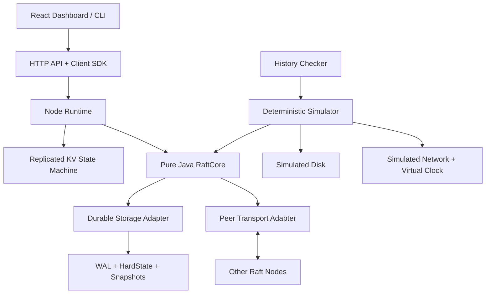

# QuorumLab — техническая спецификация v1.0

**Статус:** проектный документ (реализация ещё не начата)  
**Дата:** 6 ноября 2026 г.  
**Назначение:** инженерный портфолио-проект / исследовательский прототип  
**Основной язык:** Java 21  
**Главный критерий успеха:** доказуемая тестами корректность поведения в заданной модели отказов, а не максимальная скорость.

---

## 1. Цель и позиционирование

QuorumLab — распределённая key-value база данных с собственным алгоритмом Raft и встроенной лабораторией детерминированной симуляции отказов. Не является заменой PostgreSQL, etcd или FoundationDB и **не предназначена для использования с реальными критичными данными** без внешнего аудита.

Основные инженерные результаты:

1. Собственная реализация `RaftCore`, не зависящая от Spring, сети, часов и файловой системы.
2. Восстанавливаемый дисковый журнал (WAL), persistent metadata, snapshots.
3. Линейризуемые операции `GET`, `PUT`, `DELETE`, `CAS` в единственной Raft-группе из трёх фиксированных голосующих узлов.
4. Контроль повторных мутаций через `(clientId, requestSeq)` при ограничении *один одновременно выполняемый запрос на клиентскую сессию*.
5. Детерминированный симулятор с виртуальным временем, сетью и диском; воспроизведение по seed + trace.
6. Реальные интеграционные тесты на трёх процессах и тесты с введёнными отказами.
7. Панель наблюдения за выборами лидера, журналами, commit/applied index и испытаниями.

### Вне объёма v1.0

- SQL, вторичные индексы, сложные запросы, транзакции между несколькими ключами, шардирование.
- Динамическое изменение состава Raft-группы, reconfiguration/joint consensus.
- Многорегиональное развёртывание, multi-tenancy, production-ready auth/TLS и аудит безопасности.
- Lease-based reads, лидерские lease при несинхронизированных часах.
- Exactly-once delivery по сети. В сети возможны повторения, неопределённые тайм-ауты.
- Гарантии надёжности при неисправном оборудовании, нарушающем контракт `fsync`, или непроверенной файловой системе.

**Почему такие границы:** задача — завершить проверяемое ядро. «Много функций» не заменяет доказательств, что потеря лидера не испортит подтверждённые данные.

## 2. Модель системы, отказов и гарантий

### Топология

- Один кластер = одна Raft-группа, **ровно 3 voting nodes** с постоянными `clusterId` и `nodeId`.
- Один узел = отдельный JVM-процесс и собственный каталог данных.
- Один лидер в рамках term; follower/candidate/leader.
- Majority = 2 из 3. При доступности большинства система может делать прогресс после выбора лидера; при потере большинства **не подтверждает новые записи и линейризуемые чтения**.
- Сеть асинхронная: сообщения могут задерживаться, дублироваться, теряться, приходить не по порядку. Нет предположения о фиксированном верхнем пределе задержки для безопасности; для живости нужен период стабильной связи и подходящие тайм-ауты.
- Узлы crash-stop с последующим restart, а не Byzantine: они не подделывают сообщения намеренно.

### Safety (обязательные инварианты)

- **S-01 Election safety:** не более одного легитимно избранного лидера для каждого term.
- **S-02 Vote safety:** голос и term сохраняются до ответа на `RequestVote`.
- **S-03 Log matching:** одинаковые `(index, term)` подразумевают одинаковый префикс журнала.
- **S-04 Leader completeness:** подтверждённая запись присутствует в журнале каждого будущего лидера (в логическом смысле, включая snapshot).
- **S-05 State machine safety:** ни два узла не применяют разные команды с одинаковым индексом.
- **S-06 Commit discipline:** лидер продвигает `commitIndex` подсчётом большинства только для записей своего **текущего term**; более старые подтверждаются косвенно.
- **S-07 Apply discipline:** `lastApplied <= commitIndex <= lastLogIndex` с учётом `lastIncludedIndex` после compaction; комманды применяются строго по порядку.
- **S-08 Durability:** успех мутации выдаётся только после долговечной записи на quorum и локального применения подтверждённой команды лидером.
- **S-09 Linearizability:** завершённая операция согласуется с некоторым последовательным порядком, соблюдающим порядок реального времени не перекрывающихся клиентских операций.
- **S-10 Deduplication:** один логический клиентский запрос с одинаковыми `(clientId, requestSeq, payloadHash)` не меняет состояние дважды, даже после replay/snapshot в рамках оговорённой модели клиента.

### Liveness (при условии стабильности)

- **L-01:** если минимум два узла работают и обмениваются сообщениями достаточно долго, выбирается лидер.
- **L-02:** при стабильном лидере и работающем большинстве записываемые команды завершаются.
- **L-03:** отставший узел догоняет по журналу или snapshot.

**Важно:** в полностью асинхронной сети нельзя обещать фиксированное время выборов или прогресс при произвольных задержках. Безопасность и доступность — разные требования.

## 3. Функциональные требования

| ID | Функция | Приёмка |
|---|---|---|
| FR-01 | Запуск трёх фиксированных узлов | Каждый поднимается на отдельном порту и каталоге; повторная инициализация чужим clusterId запрещена |
| FR-02 | Election | В стабильной сети избирается лидер; после отключения лидера возможна переизбрание |
| FR-03 | Replication | Лидер добавляет команды в лог, followers сверяют `prevLogIndex/Term`, исправляют конфликтующие **неподтверждённые** суффиксы |
| FR-04 | PUT | Успешное значение видно в последующем линейризуемом GET |
| FR-05 | GET | Нельзя возвращать устаревшее значение с изолированного бывшего лидера |
| FR-06 | DELETE | Детерминированное удаление с tombstone/revision для защиты от ABA |
| FR-07 | CAS | Изменение только при совпадении ожидаемой revision |
| FR-08 | Deduplication | Повтор той же последовательности клиента возвращает прежний результат без повторного применения |
| FR-09 | WAL recovery | Подтверждённые операции остаются после перезапусков; незавершённая запись не выдаётся как успешно сохранённая |
| FR-10 | Snapshot + compaction | Позволяет удалить старый префикс журнала после durable checkpoint |
| FR-11 | InstallSnapshot | Сильно отставший follower синхронизируется от лидера |
| FR-12 | Fault simulator | Управляемые паузы, потери, дублирования, разделения сети, crashes, disk failures |
| FR-13 | Reproducibility | По seed и event trace воспроизводится последовательность решений и сбоев |
| FR-14 | Observability | Термин, роль, лидер, commit/applied index, лог, число RPC, метрики latency и failure |
| FR-15 | Docker deployment | Локальный кластер поднимается одной командой и тестируется по API |

### API v1

- `PUT /v1/kv/{key}`: `{"valueBase64":"aGVsbG8="}`.
- `GET /v1/kv/{key}`: ответ `{"valueBase64":"aGVsbG8=","revision":42}`.
- `DELETE /v1/kv/{key}`.
- `POST /v1/kv/{key}/cas`: `{"expectedRevision":42,"valueBase64":"bmV3"}`.
- `GET /v1/status`: read-only диагностический status; **не** является линейризуемым KV-чтением.

Для всех *мутаций* заголовки `X-Client-Id` (UUID) и `X-Request-Seq` (монотонное целое > 0). Клиентская библиотека допускает один in-flight запрос на `clientId` и повторяет сетевой запрос с теми же идентификаторами и байтами команды. State machine хранит последнюю завершённую последовательность, её хэш и результат для каждого клиента; старые sequence возвращают `STALE_SEQUENCE`, пропуски — `OUT_OF_ORDER`. Результаты должны входить в snapshot.

**Ограничения:** ключ — UTF-8 до 256 байт; значение — до 64 KiB; ограничение на число клиентских сессий фиксируется конфигурацией; клиентские сессии v1 не удаляются автоматически. Запросы, нарушающие лимиты, отклоняются до отправки в Raft. Не описывать эту схему как глобальный «exactly-once delivery».

**Ревизии:** mutation, успешно изменившая ключ, присваивает ему значение соответствующего Raft log index. Tombstone содержит последнюю revision, даже если значение удалено. CAS по revision предотвращает незаметное ABA (создание → удаление → создание с тем же значением).

**Коды/ошибки:**

- `200/201` успех; `404 KEY_NOT_FOUND`;
- `412 CAS_MISMATCH` (результат фиксируется как детерминированное выполнение мутации);
- `409 NOT_LEADER` с `leaderHint` при известном адресе;
- `503 NO_QUORUM` если запрос не может завершиться;
- `504 OUTCOME_UNKNOWN` при timeout: **операция может быть подтверждена**; клиент повторяет *тот же request id*, а не генерирует новый;
- `400 INVALID_ARGUMENT/OUT_OF_ORDER/STALE_SEQUENCE`.

Для простоты GET направляется лидеру. Первая корректная реализация выполняет GET через Raft-log (дорого, но просто); позднее — протокол quorum-backed **ReadIndex**: новый лидер сначала подтверждает запись своего term, затем удостоверяется в актуальном лидерстве через quorum и ждёт `lastApplied >= readIndex`. Не использовать локальное чтение лидера без проверки quorum.

### Пример пользовательского сценария

1. Клиент `c1` PUT `currency/USD=500`, sequence 1 → записано в журнал 2+ узлов, применено лидером → `revision=15`.
2. Клиент `c2` GET `currency/USD` после ответа PUT → `500`.
3. Лидер отключается; из двух оставшихся выбирается новый лидер.
4. `c1` повторяет тот же PUT с sequence 1 → прежний результат, без повторного изменения данных.
5. Старая изолированная машина после restart не может подтвердить несогласованную новую операцию.

### Нефункциональные требования (NFR)

| ID | Требование | Проверяемость |
|---|---|---|
| NFR-01 | Критические safety-инварианты сохраняются при рассматриваемых network/crash faults | Deterministic simulation + independent history checker |
| NFR-02 | Подтверждённые записи восстанавливаются из persisted state | Crash/restart + WAL/snapshot tests |
| NFR-03 | При отсутствии quorum нет ложноположительных ответов на линейризуемые KV операции | 1/3 active, partitions, stale leader tests |
| NFR-04 | Ядро не зависит от real time, сети, файловой системы и framework | Dependency rules/ArchUnit, simulated runtime |
| NFR-05 | Любой тестовый failure trace воспроизводится в том же build | Seed + full trace + reproducibility assertion |
| NFR-06 | Метрики и структурированные логи позволяют объяснить election/commit/recovery | Dashboard, traces, test assertions |
| NFR-07 | CI на каждом PR проверяет unit/property/deterministic smoke | GitHub Actions required checks |
| NFR-08 | Все wire/disk форматы версионированы; несовместимый формат явно отклоняется | Version mismatch tests |
| NFR-09 | В рабочем окружении v1 слушает только localhost/изолированную сеть | Container/port validation; no public deployment |
| NFR-10 | Производительность измеряется воспроизводимо, а не декларируется | Benchmark manifest + hardware/JVM settings |

### Peer RPC schema (логически, поверх Protobuf/gRPC)

```text
RequestVoteReq { term, candidateId, lastLogIndex, lastLogTerm }
RequestVoteResp { term, voteGranted }
AppendEntriesReq { term, leaderId, prevLogIndex, prevLogTerm,
                   entries[], leaderCommit }
AppendEntriesResp { term, success, matchIndex, conflictIndex?, conflictTerm? }
InstallSnapshotReq { term, leaderId, lastIncludedIndex,
                     lastIncludedTerm, chunkOffset, chunkData, done }
InstallSnapshotResp { term, accepted, nextOffset? }
```

**Почему протокол и transport разделены:** gRPC облегчает сетевую часть, но при тестировании эти же сообщения доставляет виртуальная сеть. Бинарные сообщения сериализуются по схеме с версией; запрещено напрямую передавать Java-объекты между узлами.

### Пример локальной конфигурации

```yaml
clusterId: quorumlab-local-1
nodeId: n1
members:
  - {id: n1, peer: "127.0.0.1:7101"}
  - {id: n2, peer: "127.0.0.1:7102"}
  - {id: n3, peer: "127.0.0.1:7103"}
clientHttp: "127.0.0.1:8101"
dataDir: "./data/n1"
heartbeatIntervalMs: 75
electionTimeoutMinMs: 400
electionTimeoutMaxMs: 800
maxValueBytes: 65536
walSegmentSizeBytes: 67108864
```

Числа — **стартовая конфигурация для локальных экспериментов**, не production-SLA. `nodeId` и `dataDir` уникальны для каждого процесса; `clusterId` и membership одинаковы. Тайм-ауты должны быть рандомизированы и настраиваемы, а в симуляторе интерпретируются через виртуальные ticks.

## 4. Архитектура



### Модули Gradle

```text
quorumlab/
├── settings.gradle.kts
├── build.gradle.kts
├── docs/
│   ├── architecture.md
│   ├── consistency-model.md
│   ├── failure-model.md
│   ├── adr/
│   └── benchmark-methodology.md
├── proto/
├── quorum-core/          # Event → Effects, Raft algorithm; JDK only
├── quorum-storage/       # WAL, stable state, snapshots, recovery
├── quorum-transport/     # gRPC/Protobuf peer messages
├── quorum-kv/            # deterministic KV + client dedup
├── quorum-node/          # production runtime, event loop, APIs
├── quorum-client/        # client retries, leader rediscovery
├── quorum-simulator/     # virtual time/network/disk, traces
├── quorum-checker/       # history checker + invariant assertions
├── quorum-integration/   # multiprocess tests, Toxiproxy
├── quorum-bench/         # workloads + result processing
├── quorum-dashboard/     # React UI (после рабочей системы)
└── docker-compose.yml
```

### Главная абстракция: чистое ядро

```java
interface RaftCore {
    List<Effect> step(RaftEvent event);
}

sealed interface RaftEvent {
    // Tick, RpcReceived, ClientProposal, PersistCompleted,
    // PersistFailed, ApplyCompleted, SnapshotInstalled ...
}

sealed interface Effect {
    // PersistBatch, SendRpc, ScheduleTimer,
    // ApplyCommittedEntries, CompleteClientRequest ...
}
```

`RaftCore` не вызывает `System.currentTimeMillis()`, `Thread.sleep`, сокеты или `FileChannel`. Время, сеть, диск и генератор случайных тайм-аутов передаются адаптерами. Драйвер исполняет эффекты с правильными зависимостями: ответ на голос и положительный ответ на запись отправляются **только после подтверждения нужного durable persistence**. `PersistCompleted` — отдельное событие. Это критично: «чистая функция» сама по себе не делает storage безопасным.

**Обоснование:** одна и та же логика запускается поверх настоящего диска и поверх симулятора. Для симуляции не нужно переписывать Raft; снижается риск, что симулятор проверяет *другой* алгоритм.

### Разделение ответственности

- **Core:** термы, состояния узлов, RequestVote, AppendEntries, replication progress, current-term commit rule, snapshots (protocol part).
- **Storage:** стабильный журнал, `currentTerm/votedFor`, сохранение `commitIndex`, snapshot files, integrity checks и replay.
- **KV:** применение *только committed entries*, значений/revisions/tombstones, CAS и client dedup.
- **Runtime:** очереди событий, границы persist/send/apply, backpressure, graceful stop, RPC и API.
- **Simulator:** виртуальные часы и очередь событий, сети/диски, crash/restart и трассы.
- **Checker:** независимая модель KV, проверка histories и инвариантов.

### Почему не PostgreSQL, Kafka, Redis и Spring внутри ядра

Использование готового консенсуса/базы данных скроет наиболее интересные инженерные задачи. PostgreSQL, Kafka и Redis не нужны как обязательная runtime-зависимость QuorumLab. Spring Boot допустим для административного HTTP API и демо, gRPC/Protobuf — для кодирования peer RPC; сам Raft и запись в собственный WAL остаются авторскими.

## 5. Raft protocol: минимально необходимая реализация

Persistent state каждого узла:

```text
clusterId, nodeId
currentTerm, votedFor
log[entryIndex] = {term, type, serializedCommand, checksum}
commitIndex (пишем в WAL/HardState для удобства recovery)
snapshot = {lastIncludedIndex, lastIncludedTerm, stateMachineImage}
```

Volatile: `role`, `leaderId`, `lastApplied`, election/heartbeat timers; у лидера `nextIndex[follower]` и `matchIndex[follower]`.

**Важно:** `commitIndex`, включённый в устойчивую метаинформацию, должен сохраняться только после durable log entries, на которые ссылается. При restart `lastApplied` восстанавливается из snapshot + replay применимых committed entries, не по ненадёжной памяти.

Путь записи:

1. API валидирует команду; при известном follower возвращает `NOT_LEADER`.
2. Лидер добавляет `(term,index,command)` в свой журнал.
3. Storage делает durable append перед сообщениями, зависящими от этой записи.
4. Лидер отправляет AppendEntries; follower проверяет `(prevLogIndex,prevLogTerm)`, корректирует только безопасный suffix, принудительно сохраняет запись до успешного ответа.
5. Лидер видит подтверждение **устойчивой** репликации большинством; `commitIndex` продвигается только до индексов записей текущего term, достаточных по `matchIndex`.
6. После persist необходимых commit metadata и локального apply state machine выдаёт результат конкретному ожидающему клиенту.
7. Followers получают обновлённый leaderCommit и применяют тот же порядок команд.

Путь election:

1. После randomized timeout follower становится candidate и повышает term.
2. Durable persist `(currentTerm,votedFor=self)` до отправки зависящих от него голосований.
3. RequestVote содержит `(term,candidateId,lastLogIndex,lastLogTerm)`.
4. Голосовать разрешено только за подходящего кандидата с актуальным журналом; один голос за term; перед ответом — persist.
5. Majority votes → leader; append **NO_OP в текущем term** и commit его до обслуживании оптимизированных ReadIndex.
6. Более высокий term в сообщении → step-down, persist term/vote before dependent responses.

**Специальные проверки:** split votes, conflict suffix, Figure 8 из Raft paper, старые кандидаты с неактуальным журналом, повторные/запаздывающие сообщения, отменённые предложения после смены лидера.

## 6. Storage engine

### WAL

Append-only сегменты, каждый record:

```text
[magic:4][formatVersion:2][recordType:1][payloadLength:4]
[payload:N][crc32c:4]
```

Служебные записи: `SET_HARD_STATE`, `APPEND_ENTRY`, `TRUNCATE_SUFFIX`, `SET_COMMIT_INDEX`. На replay применяем только полный record с корректной контрольной суммой. При повреждении последнего незафиксированного хвоста разрешается **строго определённая recovery-policy**: обнаруженный incomplete tail отбрасывается, но коррупция устойчивых данных в середине файла → startup FAIL_CLOSED, не молчаливый успех.

Для недвусмысленной recovery границы устойчивости фиксируем durable checkpoint/segment-offset; проверяем реализацию crash-тестами. На Linux использовать `FileChannel.force(true)` и проверять поведение файловой системы; одна только симуляция `kill -9` не доказывает стойкость к реальному power loss.

### Snapshots

- Snapshot содержит `lastIncludedIndex`, `lastIncludedTerm`, KV keys+values+revisions/tombstones, dedup states, формат, checksum.
- Сборка snapshot из согласованного state-machine состояния на определённом `lastApplied`.
- Запись `snapshot.tmp` → `force` → атомарный rename/manifest update с проверенной durable ordering → compact старого журнала только после durable checkpoint.
- Если `atomic move` или directory fsync недоступны на платформе, алгоритм должен иметь проверенную альтернативу; поддержка v1 ограничена Linux.
- Отстающий follower устанавливает snapshot с корректным индексом/term, затем получает последующие log entries.

**Почему не LSM-tree сразу:** для демонстрации распределённой согласованности достаточно in-memory state machine + собственный durable Raft WAL + snapshots. Собственный LSM-tree — отдельный большой проект; добавим лишь после корректного Raft.

## 7. Детерминированный Chaos Lab

Симулятор выполняет узлы в **одном потоке** с виртуальным временем и приоритетной очередью событий:

`(logicalTime, insertionOrder, eventType, targetNode, payload)`.

Seed определяет последовательность псевдослучайных выборов. Trace записывает точные решения планировщика и fault-инъекции, а также version алгоритма/конфигурации; воспроизведение должно использовать тот же build и trace. Seed сам по себе не гарантирует идентичность между различными версиями программы.

Поддерживаемые faults:

- Drop/delay/duplicate/reorder RPC; network partition с направленными фильтрами.
- Pause/resume/crash/restart node; после crash volatile state сбрасывается, диск сохраняет только то, что было подтверждено симулированным `force`.
- Disk write delay/failure/ENOSPC/partial last record.
- Client timeout, retry, lost response; некоторые операции остаются с неизвестным итогом.
- Clock ticks — виртуальные; не использовать реальные системные часы в ядре.

В симуляции сначала задаём модель отказа, затем гарантии. Crash перед `force` может потерять buffer; crash после `force` обязан сохранить его. Для реального `power loss` нужен отдельный hardware/system-test и осторожные утверждения.

### Пример trace

```json
{"seed":11842,"at":100,"event":"ELECT","node":"n1","term":2}
{"seed":11842,"at":151,"event":"DROP_RPC","from":"n1","to":"n3"}
{"seed":11842,"at":191,"event":"CRASH","node":"n1"}
{"seed":11842,"at":520,"event":"RESTART","node":"n1"}
```

Требование: при обнаружении нарушения сохранять minimal failing trace (упрощение/delta debugging — дополнительный этап), журнал клиентских операций, seed, manifest с Git commit/version и отчёт checker.

## 8. Требования к тестированию

### 8.1. Unit tests (каждый commit)

- Transition tests для Role/Term/Vote: выборы, step-down, голосование только за актуальный log.
- AppendEntries: consistency checks, conflict repair, сохранение committed prefix.
- Commit current-term rule, особенно Figure 8.
- State-machine: PUT, DELETE, CAS, revision, deduplication, replay.
- WAL record encode/decode, partial/corrupt records, версии формата.
- Snapshot content, checksum, границы compaction, restore.

### 8.2. Model/property tests (каждый PR)

Генерировать случайные последовательности операций и сравнительно проверять:

- Все применённые на разных узлах committed entries совпадают по index/term/command.
- Один term не имеет двух законно избранных лидеров.
- `lastApplied` не превосходит `commitIndex`.
- Идемпотентность клиентских команд сохраняется после перезапуска.
- Recovery выдаёт то же состояние, что модель replay.

Использовать jqwik для property-based generators. Для коротких историй KV — независимый checker линейризуемости с перебором допустимых последовательностей, учитывающий интервалы invocation/completion. Затем запустить внешний checker (Jepsen/Knossos или Porcupine) для более широких traces. **Проверка «все узлы в конце одинаковые» недостаточна**: она не доказывает линейризуемость.

### 8.3. Deterministic simulation (PR + nightly)

- 3 узла, случайные elections, 1–2 изолированных узла, потери/дублирование RPC.
- Crash перед/после `force`, после quorum persist, до клиентского ответа.
- Старый лидер возвращается после нового term.
- Все узлы теряют питание и восстанавливаются с durable state.
- Snapshot при отключении и перезапуске, install snapshot отстающему node.
- Подтверждённый PUT + последующий GET, конкурентный CAS, повтор запроса после неопределённого таймаута.

Число seeds растёт по мере устойчивости. **Плановые gates:** PR — 100 быстрых seeds + 10 regression traces; nightly — минимум 10 000 seeds в отдельном вычислительном бюджете. Если выполнение слишком долгое, помечаем целевой объём как не достигнутый; не заявляем «проверено 10 000», пока реально не выполнено.

### 8.4. Integration / real process (PR и release)

- Три отдельные JVM + отдельные каталоги данных.
- Реальный peer transport, client REST, повторные подключения, graceful stop/kill.
- Docker/Testcontainers; Toxiproxy для задержек, разрывов и packet loss.
- При `1/3` отказе + устойчивой связи двух узлов кластер продолжает работу; при `2/3` — новые линейризуемые операции не завершаются успехом.
- Recovery после restart всех узлов; никакая *подтверждённая* запись не теряется.
- Полная переустановка follower из snapshot.

### 8.5. Performance / profiling (release)

Метрики: completed successful writes/s, reads/s, median/p95/p99 latency, retries, queue depth, CPU/RAM, WAL/fsync latency, election time, recovery duration, bytes per operation. Сценарии с различной concurrency (1/8/32/64), долей GET/PUT, размерами 128B/1KiB/64KiB и без/с injected faults.

**Только измеренные цифры:** фиксируем процессор, RAM, SSD, ОС, JVM, конфигурацию fsync, число клиентов, размер ключей/значений и версию кода. Начальные ориентиры для локального стенда, не обещания: `p95 ≤ 200 ms` и `≥ 100 подтверждённых writes/s` при 1KiB, 32 concurrent clients, 3 nodes, SSD, без faults. Если недостижимы, публикуем фактические результаты и профилируем узкие места, не ослабляя correctness.

### Матрица обязательных сценариев

| ID | Введённый сбой/условие | Ожидаемый результат |
|---|---|---|
| T-01 | Начальная election | После стабилизации ровно один лидер в term |
| T-02 | Split vote | Нет двух избранных лидеров для одного term |
| T-03 | Лидер отключён после успешного PUT | Новый лидер сохраняет PUT |
| T-04 | Лидер изолирован в меньшинстве | Не подтверждает PUT и линейризуемый GET |
| T-05 | 2 из 3 недоступны | Нет новых успешных KV операций |
| T-06 | Лидер умер до quorum commit | Клиент получает неизвестный исход/ошибку; не получает ложный успех |
| T-07 | Старый лидер вернулся с конфликтующим suffix | Неподтверждённый suffix исправляется; committed entries сохраняются |
| T-08 | Raft Figure 8 | Старые записи не commit по неправильному правилу |
| T-09 | Crash после quorum, до клиентского ответа | Повтор с тем же request ID не меняет состояние повторно |
| T-10 | Повторный CAS с тем же ID | Возвращён тот же результат; CAS не выполнен заново |
| T-11 | Concurrent PUT+GET | Проверка линейризуемости, учитывая интервалы времени |
| T-12 | Partial WAL tail | Восстановление по policy; нет выдуманных записей |
| T-13 | Коррупция середины WAL | FAIL_CLOSED с диагностикой |
| T-14 | Crash до/после snapshot rename | Восстановление из последнего *durable* состояния |
| T-15 | Follower далеко отстал | Догоняет через InstallSnapshot |
| T-16 | Повторение trace при фиксированном билде | Идентичные переходы событий и результат проверки |
| T-17 | Диск вернул ENOSPC | Нет успеха на недолговечных данных; узел сообщит об ошибке |
| T-18 | Все три узла перезапущены | Все подтверждённые записи сохранены |

### Definition of Done для v1.0

- Все обязательные тесты T-01…T-18 проходят, негативные сценарии действительно воспроизводятся.
- Нет известных safety/linearizability violations; каждый обнаруженный баг оформлен trace и регрессионным тестом.
- Unit/core coverage: ориентир `≥ 90% line` + целевой `≥ 80% branch`; *покрытие не равно корректности*.
- Каждый PR проходит build, static analysis, unit, property smoke, deterministic smoke; release/nightly запускает длительную симуляцию и мультипроцессные сценарии.
- В README представлены демонстрация, архитектура, формальная модель гарантий, известные ограничения и воспроизводимые команды.
- Бенчмарки отражают фактические результаты; неизвестные свойства не рекламируются как гарантии.

## 9. Этапы и поставки

| Этап | Поставляемый результат | Gate завершения |
|---|---|---|
| M0 — Foundation | Gradle multimodule, ADR-001 scope/consistency/failure model, CI skeleton | `./gradlew test` на пустом каркасе + зафиксированные интерфейсы |
| M1 — Storage | WAL record codec, durable HardState, replay, integrity checks | WAL roundtrip/crash-recovery tests |
| M2 — Raft Election | Три simulated nodes, term/vote, randomized timeouts, RequestVote | Election/step-down/split vote + restart tests |
| M3 — Log Replication | AppendEntries, conflict repair, match/nextIndex, commit rule | Figure 8 + safety simulation |
| M4 — KV + Client | PUT/GET(log-based)/DELETE/CAS, revisions, dedup, real client SDK | End-to-end linearizable scenarios, retry tests |
| M5 — Real Cluster | gRPC peers, HTTP API, three JVM processes, Docker Compose | 3 nodes + one-node failure tests |
| M6 — Snapshot | Durable snapshot, compaction, InstallSnapshot, restore | Snapshot crash matrix + lagging follower |
| M7 — Chaos Lab | Virtual clock/network/disk, seed+trace, safety assertions | Replay of saved counterexamples + nightly seeds |
| M8 — Deep Validation | External history checker, real network faults, benchmarking | Release acceptance matrix + reproducible results |
| M9 — Showcase | React dashboard, docs, architecture diagrams, demo video | New reviewer reproduces demo from README |

**Ориентир планирования:** 12–20 недель при регулярной работе над проектом; объём зависит от опыта с Raft и отладки. Не начинать M9 до прохождения M4–M8. Каждая стадия — законченный pull request/релиз с тегом.

### Первые 12 задач для GitHub Issues

1. `QL-001` Зафиксировать scope, API semantics, failure model и ADR-001.
2. `QL-002` Создать Gradle multi-module project и CI.
3. `QL-003` Определить `RaftEvent`, `Effect`, immutable DTO и clock abstraction.
4. `QL-004` Реализовать детерминированный event scheduler для unit-тестов.
5. `QL-005` Сформировать WAL binary format и codec с CRC32C.
6. `QL-006` Реализовать persist/replay HardState и WAL recovery.
7. `QL-007` Реализовать follower/candidate/leader transitions.
8. `QL-008` RequestVote, currentTerm/votedFor persistence ordering.
9. `QL-009` Unit-test election safety и split-vote.
10. `QL-010` AppendEntries consistency check и log append.
11. `QL-011` Leader replication state (`nextIndex`, `matchIndex`).
12. `QL-012` Current-term commit rule + Figure 8 regression test.

## 10. Практические принципы разработки

1. **Один PR — один инвариант/вертикальный срез.** Большие изменения алгоритма нельзя принимать без regression tests.
2. **Без «fake success».** В README различать реализовано, экспериментально проверено, запланировано.
3. **Документировать ADR.** Например: ADR-001 fixed membership, ADR-002 pure event core, ADR-003 sync durability, ADR-004 linearizable read strategy.
4. **Готовые Raft реализации — как эталон для чтения, но не runtime dependency.** Изучать `etcd-io/raft` и проверять нюансы persistence ordering.
5. **Работать от тестов к коду.** Сначала failing test, затем minimal implementation, затем стресс/fault/benchmark.
6. **Без необоснованных заявлений.** «Протестировано 10 тысяч deterministic seeds» не означает математического доказательства корректности. «Работает с 2/3 доступных узлов» означает доступное *большинство*, а не любое два из трёх при разделённой сети.
7. **Безопасность.** MVP слушает `127.0.0.1` или изолированную Docker-сеть. Не открывать тестовую неаутентифицированную базу данных в публичный интернет.

## 11. Показательное демо для работодателя

1. Запустить три ноды и dashboard, записать `account/A = 100`, прочитать 100.
2. Подтвердить запись и принудительно остановить лидера.
3. Показать election нового лидера, прочитать ранее подтверждённое значение.
4. Отрезать новый лидер от quorum и показать, что он **не** выдаёт ложный успешный ответ на write/read.
5. Восстановить сеть и завершить запись, проверить состояние всех реплик.
6. Включить `Chaos Lab`, найти и автоматически воспроизвести заранее подготовленный regression trace.
7. Открыть историю операций и отчёт linearizability checker, показать тест Figure 8.
8. Показать WAL и recovery после перезапуска всех трёх процессов, затем отчёт бенчмарка с характеристиками машины.

Главный показатель инженерного уровня: не UI, а способность **объяснить любой переход состояния, границы гарантий и причины выбора алгоритма**.

## 12. Основные источники

1. Raft project + original paper — https://raft.github.io/
2. MIT 6.5840 Spring 2026 Raft lab — https://pdos.csail.mit.edu/6.5840/labs/lab-raft1.html
3. MIT 6.5840 Spring 2026 KV lab — https://pdos.csail.mit.edu/6.5840/labs/lab-kvraft1.html
4. etcd Raft implementation/documentation — https://github.com/etcd-io/raft
5. FoundationDB Simulation and Testing — https://apple.github.io/foundationdb/testing.html
6. Jepsen Knossos — https://github.com/jepsen-io/knossos
7. Testcontainers Toxiproxy — https://testcontainers.com/modules/toxiproxy/

---

**Документ задаёт требования и критерии приёмки; код, тесты и достигнутые характеристики ещё не заявлены как существующие.**
